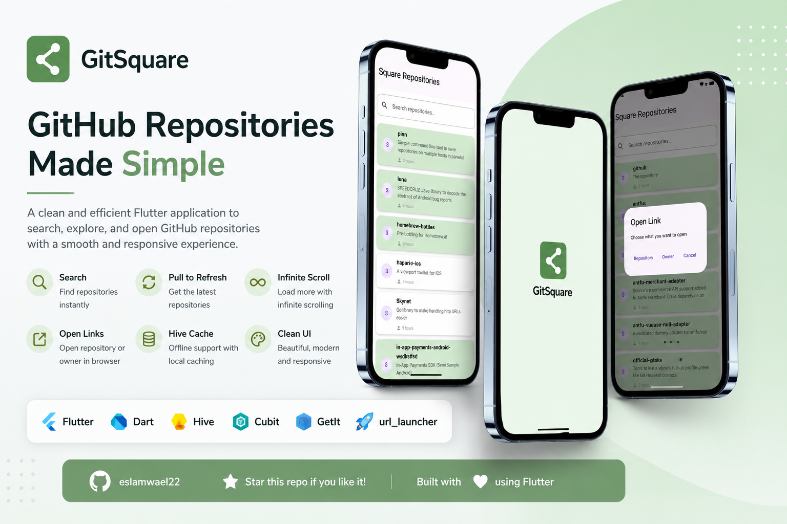

# 🚀 GitSquare

<p align="center">
  
</p>

<p align="center">
A clean and responsive Flutter application for browsing GitHub repositories with local caching, pagination, search, and pull-to-refresh.
</p>

<p align="center">
  
  
  
  
  
</p>

---

# ✨ Features

✅ Browse GitHub repositories

✅ Search repositories instantly

✅ Infinite Scrolling (Pagination)

✅ Pull To Refresh

✅ Offline Cache using Hive

✅ Open Repository URL

✅ Open Owner Profile

✅ Responsive UI

✅ Clean Architecture

✅ Repository Pattern

✅ Dependency Injection

---


# 🏛 Architecture

```
lib
│
├── business_logic
│   └── cubit
│
├── core
│   ├── network
│   └── services
│
├── data
│   ├── datasource
│   │     ├── local
│   │     └── remote
│   ├── models
│   └── repositories
│
├── presentation
│   ├── screens
│   └── widgets
│
└── main.dart
```

---

# 📦 Packages

| Package | Purpose |
|----------|---------|
| flutter_bloc | State Management |
| dio | API Requests |
| hive | Local Database |
| hive_flutter | Hive Initialization |
| hive_generator | Generate Hive Adapter |
| build_runner | Generate Files |
| get_it | Dependency Injection |
| url_launcher | Open Repository Links |
| equatable | Compare States |

---

# ⚙️ Technologies

- Flutter
- Dart
- Cubit
- Clean Architecture
- Repository Pattern
- Dependency Injection
- REST API
- Hive Local Storage

---

# 📂 API

Data is fetched from:

https://api.github.com/orgs/square/repos

---

# 🚀 Getting Started

Clone the project

```bash
git clone https://github.com/eslamwael22/github_square.git
```

Install packages

```bash
flutter pub get
```

Run the app

```bash
flutter run
```

